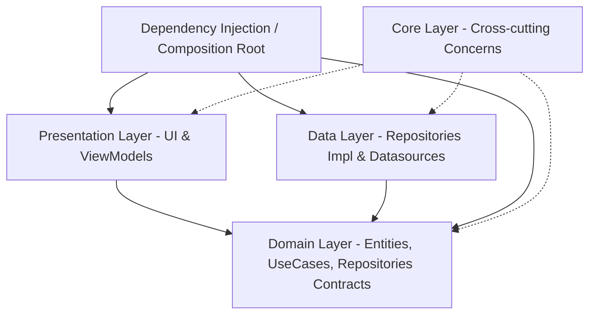

# Arquitetura Limpa (Clean Architecture) - Especificação Técnica e Diretrizes de Design

Este documento descreve a especificação arquitetural adotada no projeto, estabelecendo um padrão de **Clean Architecture** altamente testável, desacoplado de frameworks e independente de interfaces de usuário (UI). O objetivo principal desta especificação é servir como um **template de referência reutilizável** para qualquer outro projeto Flutter/Dart, independente de sua regra de negócio.

---

## 1. Princípios Fundamentais

A arquitetura baseia-se nos princípios de Clean Architecture propostos por Robert C. Martin, adaptados para o ecossistema Dart/Flutter. Ela garante:

*   **Independência de Frameworks**: O núcleo de negócios (Domain) não depende do Flutter ou de qualquer biblioteca externa de terceiros.
*   **Testabilidade**: Regras de negócio podem ser totalmente testadas unitariamente sem a necessidade de emuladores, widgets ou dependências externas.
*   **Independência de UI**: A interface gráfica pode mudar completamente (de Flutter Mobile para Flutter Web, ou até mesmo CLI) sem impactar as regras de negócio.
*   **Independência de Banco de Dados/APIs**: A forma como os dados são consumidos ou salvos (REST API, GraphQL, SQLite, Firebase) é tratada como um detalhe de infraestrutura na camada mais externa.

---

## 2. O Fluxo de Dependências

Todas as dependências apontam estritamente para o centro (a camada de **Domain**). As camadas externas dependem das camadas internas, mas as internas **nunca** sabem da existência das externas.



---

## 3. Detalhamento das Camadas

A estrutura de diretórios do projeto é organizada sob a pasta `lib/` da seguinte maneira:

```
lib/
├── core/
├── data/
│   ├── datasources/
│   └── repository/
├── dependency_injection/
├── domain/
│   ├── entities/
│   ├── enums/
│   ├── failures/
│   ├── game_logic/   (ou [business_logic])
│   ├── repository/
│   ├── usecases/
│   └── value_objects/
├── presentation/
│   ├── app.dart
│   ├── routes/
│   ├── ui/
│   └── view_model/
└── main.dart
```

### 3.1 Camada de Domínio (`lib/domain/`)
É o coração da aplicação. Contém apenas código Dart puro. **Esta camada não pode conter imports de pacotes do Flutter (ex: `package:flutter/material.dart`) ou de outras camadas do projeto (como `data` ou `presentation`).**

Responsabilidades internas:
*   **`Entities`**: Objetos de negócios complexos que mantêm o estado e contêm regras de negócios próprias que são válidas de forma ampla na aplicação.
*   **`Value Objects`**: Objetos que encapsulam tipos primitivos (ex: strings, inteiros) e garantem que eles sejam válidos logo em sua criação. Evitam a propagação de estados inválidos pela aplicação (ex: um ID não-nulo, um e-mail válido, coordenadas válidas).
*   **`Enums`**: Enums aprimorados (Enhanced Enums) para representar estados finitos de forma tipada e segura.
*   **`Repository Contracts`**: Interfaces abstratas que definem os contratos de dados. O domínio dita *o que* precisa para funcionar; a implementação concreta de *como* obter esses dados é delegada para a camada de `Data` (Inversão de Dependência).
*   **`Use Cases`**: Classes com uma única responsabilidade (Single Responsibility Principle) que executam um fluxo de negócios específico. Orquestram o fluxo de dados vindos e indo dos Repositórios e Entidades.
*   **`Failures`**: Representações tipadas de falhas esperadas do sistema. O domínio não lança exceções inesperadas para regras de negócio não atendidas; em vez disso, ele retorna objetos do tipo `Failure`.

### 3.2 Camada de Dados (`lib/data/`)
É responsável por prover dados para a aplicação. Ela implementa as interfaces abstratas definidas na camada de Domínio.

Responsabilidades internas:
*   **`Datasources`**: Responsáveis diretos pela comunicação externa (chamadas HTTP, consultas a bancos de dados locais, SDKs como Firebase, etc.). Eles não conhecem regras de negócio; apenas realizam a operação de E/S de dados brutos e lançam exceções técnicas (ex: `ServerException`, `CacheException`) se algo der errado.
*   **`Repository Implementations`**: Implementam os contratos de repositórios do Domínio. Elas chamam os `Datasources` correspondentes, capturam eventuais exceções técnicas da infraestrutura e as traduzem em objetos `Failure` tipados de Domínio antes de repassá-las aos Use Cases.

### 3.3 Camada de Apresentação (`lib/presentation/`)
Responsável por tudo relacionado à exibição visual e interação com o usuário.

Responsabilidades internas:
*   **`View Models / Stores (State Management)`**: Classes responsáveis por manter o estado da tela correspondente, reagir a ações do usuário chamando os `Use Cases` do Domínio e atualizar a UI de forma reativa. Nesta arquitetura, o estado reativo é mantido por herdados reativos como o **MobX** (ou BLoC/Cubit), mantendo o código dos Widgets livre de lógica de apresentação.
*   **`UI / Widgets`**: Widgets declarativos estruturados do Flutter. Eles devem ser "burros" (stateless sempre que possível), apenas consumindo estados das Stores/ViewModels e acionando callbacks ou chamando métodos de ação.
*   **`Routes`**: Definições de caminhos de navegação da aplicação.

### 3.4 Camada Core (`lib/core/`)
Contém utilitários genéricos reutilizáveis por todo o sistema que não pertencem a nenhuma regra de negócio específica (ex: clientes de rede genéricos, conversores, strings globais constantes, logs, etc.). A camada `Core` deve idealmente conter lógica Dart pura, mas pode conter componentes Flutter de infraestrutura neutros.

### 3.5 Camada de Injeção de Dependência (`lib/dependency_injection/`)
Funciona como o **Composition Root** (Ponto de Composição) da aplicação.
*   Centraliza a instância e amarração física de todas as dependências do sistema.
*   Faz a ligação prática entre os contratos abstratos do `Domain` e suas implementações concretas na camada de `Data`.
*   Garante que o grafo de dependências esteja pronto antes da inicialização completa do aplicativo.

---

## 4. Estratégia de Tratamento de Erros: Falhas vs. Exceções

Para obter alta previsibilidade no fluxo de erros, dividimos os problemas em duas categorias:

1.  **Exceptions (Exceções)**: Erros de infraestrutura não esperados ou falhas de hardware/rede (ex: `SocketException`, `TimeoutException`). Ocorrem **exclusivamente na camada de Data** (dentro de Datasources ou SDKs).
2.  **Failures (Falhas)**: Objetos que representam condições de erro esperadas pela lógica de negócios ou erros de infraestrutura devidamente encapsulados (ex: `InvalidEmailFailure`, `NetworkFailure`). Transitam da camada de **Data/Domain** em direção à **Presentation**.

```
[Recurso Externo / API]
         │
         ▼ (Lança Exception)
    [Datasource]
         │
         ▼ (Propaga Exception)
 [Repository Implementation] ── (Captura Exception e Mapeia para Failure)
         │
         ▼ (Retorna Failure)
     [UseCase]
         │
         ▼ (Entrega Failure)
  [ViewModel / Store] ── (Trata e decide como apresentar o erro na tela)
         │
         ▼
       [UI] (Exibe mensagem amigável de erro)
```

---

## 5. Diretrizes de Código e Padrões de Implementação (Templates)

Para replicar esta arquitetura com facilidade, utilize os seguintes modelos de código como base.

### 5.1 Template de Value Object (Rich Domain Model)
Evita tipos primitivos anêmicos. Realiza validações internas na construção.

```dart
class EmailAddress {
  final String value;

  EmailAddress(this.value) {
    if (!_isValid(value)) {
      throw ArgumentError('Email inválido fornecido: $value');
    }
  }

  static bool _isValid(String email) {
    final regex = RegExp(r'^[\w-\.]+@([\w-]+\.)+[\w-]{2,4}$');
    return regex.hasMatch(email);
  }

  @override
  bool operator ==(Object other) =>
      identical(this, other) ||
      other is EmailAddress && other.value == value;

  @override
  int get hashCode => value.hashCode;

  @override
  String toString() => value;
}
```

### 5.2 Template de Use Case (SRP)
Cada caso de uso expõe apenas um método executável (geralmente nomeado como `call` ou `execute`).

```dart
import '../failures/failure.dart';
import '../repository/user_repository.dart';
import '../entities/user_profile.dart';

class GetUserProfileUseCase {
  final UserRepository _repository;

  GetUserProfileUseCase(this._repository);

  Future<(UserProfile?, Failure?)> call(String userId) async {
    if (userId.isEmpty) {
      return (null, const InvalidInputFailure('ID do usuário não pode ser vazio.'));
    }
    return await _repository.getUserProfile(userId);
  }
}
```

### 5.3 Template de Contrato de Repositório (Domain)
Interface abstrata Dart pura.

```dart
import '../failures/failure.dart';
import '../entities/user_profile.dart';

abstract class UserRepository {
  Future<(UserProfile?, Failure?)> getUserProfile(String userId);
}
```

### 5.4 Template de Implementação de Repositório (Data)
Captura exceções técnicas do Datasource e retorna `Failure`.

```dart
import '../failures/failure.dart';
import '../../domain/repository/user_repository.dart';
import '../../domain/entities/user_profile.dart';
import '../datasources/user_remote_datasource.dart';

class UserRepositoryImpl implements UserRepository {
  final UserRemoteDatasource _remoteDatasource;

  UserRepositoryImpl(this._remoteDatasource);

  @override
  Future<(UserProfile?, Failure?)> getUserProfile(String userId) async {
    try {
      final userModel = await _remoteDatasource.fetchUser(userId);
      return (userModel.toEntity(), null);
    } on ServerException catch (e) {
      return (null, ServerFailure(e.message));
    } on SocketException {
      return (null, const NetworkFailure('Sem conexão com a internet'));
    } catch (e) {
      return (null, GeneralFailure(e.toString()));
    }
  }
}
```

### 5.5 Template do Composition Root (Dependency Injection)
Gerencia o grafo de dependências sem expor classes concretas desnecessariamente.

```dart
import 'package:flutter/foundation.dart';
import 'package:http/http.dart' as http;

import '../core/network/network_client.dart';
import '../data/datasources/user_remote_datasource.dart';
import '../data/repository/user_repository_impl.dart';
import '../domain/repository/user_repository.dart';
import '../domain/usecases/get_user_profile_use_case.dart';
import '../presentation/view_model/user_profile_store.dart';

class DependencyInjection {
  static final DependencyInjection _instance = DependencyInjection._internal();
  factory DependencyInjection() => _instance;
  DependencyInjection._internal();

  // Interfaces expostas (Domínio)
  late final UserRepository userRepository;

  // Use Cases (Domínio)
  late final GetUserProfileUseCase getUserProfileUseCase;

  // Stores / State (Presentation)
  late final UserProfileStore userProfileStore;

  void initialize() {
    // 1. Core / Infraestrutura
    final client = http.Client();
    final networkClient = NetworkClient(client);

    // 2. Data Layer
    final userRemoteDatasource = UserRemoteDatasourceImpl(networkClient);
    userRepository = UserRepositoryImpl(userRemoteDatasource);

    // 3. Domain Layer
    getUserProfileUseCase = GetUserProfileUseCase(userRepository);

    // 4. Presentation Layer
    userProfileStore = UserProfileStore(getUserProfileUseCase);

    debugPrint('DI: Grafo de dependências inicializado com sucesso.');
  }
}
```

---

## 6. Cobertura de Testes e Qualidade

Um pilar crucial desta arquitetura é a facilidade de escrita de testes automatizados:
1.  **Testes de Unidade no Domínio**: Como `domain` é Dart puro, é extremamente fácil testar todos os Use Cases, Value Objects, e Entidades mockando apenas as interfaces dos repositórios.
2.  **Testes de Unidade no Data**: Permite mockar `Datasources` para testar se os repositórios convertem corretamente as `Exceptions` em `Failures`.
3.  **Testes de Widgets e Integração**: Testes de widgets podem mockar as ViewModels/Stores para validar as renderizações sob diferentes estados reativos, sem precisar chamar o fluxo completo da aplicação.

---

Este template garante consistência e alta escalabilidade, permitindo que múltiplos times trabalhem em paralelo em diferentes camadas sem causar conflitos ou acoplamentos indesejados.
